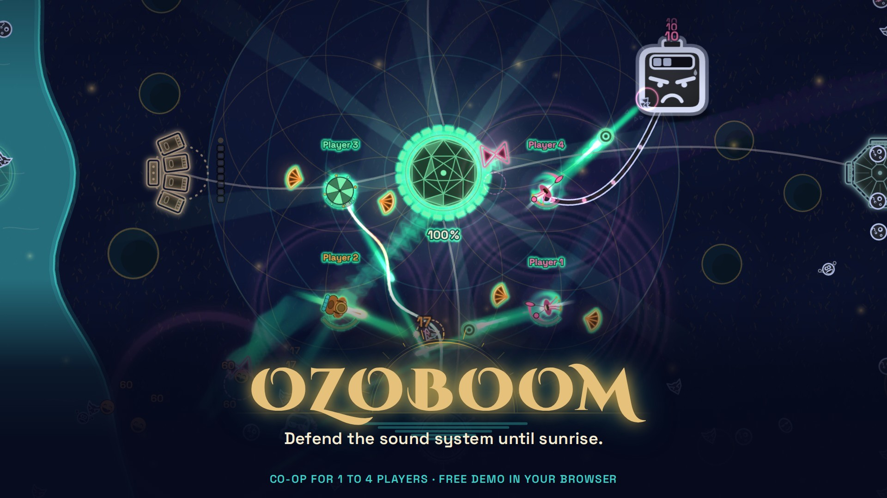
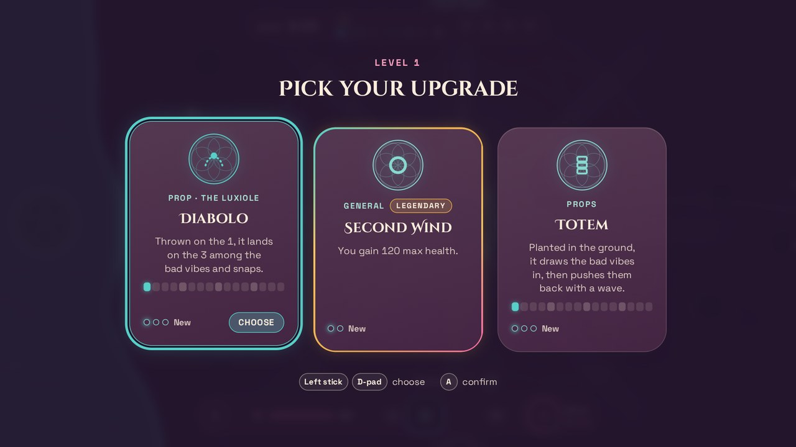

# Ozoboom

[](https://r4mbo7.github.io/Ozoboom/) [](https://brothercos.itch.io/ozoboom) [](https://discord.gg/YcEGRxaqcu)



Ozoboom is a co-op survival game (a _bullet heaven_) set at a psytrance festival. Defend the sound system against ever stronger waves of _bad vibes_, from sunset to sunrise.

[**Play the demo**](https://r4mbo7.github.io/Ozoboom/): free, in the browser, no account, nothing to install.

## Made to play together

- **1 to 4 players**: play alone or together, on one screen or online.
- **Any device**: keyboard and mouse, gamepad, or a phone's touch screen. Light enough to run on a phone.
- **Browser to browser**: online play needs no account; a phone and a computer can play in the same room. Everyone just needs the same version of the game.
- **Languages**: English, French, Spanish, Brazilian Portuguese, Arabic.

## The demo

- **The Main stage**: on the lakeshore through a whole DJ set at **145 BPM**, under a sky shifting from dusk to night, dawn and day.
- **Classes**: each player picks a class with its own weapon and skill.
- **On the beat**: everything falls on the rhythm. The core pulses on the kick, traps fire on the beat, waves arrive on the bar, and a boss lands on the drop. A dash timed on the beat goes farther.
- **To last until morning**:
  - **Weapons**: fire staff, diabolo, hoops, frisbee...
  - **Traps** made of festival gear.
  - **Extra speakers** to plug in, each one unlocking a weapon.
  - **Upgrades** that can roll rare or legendary.
  - **Fusions**: a weapon plus the right upgrade becomes a stronger weapon.
  - **Relics** dropped by bosses.

The full game, with more stages, will come out on Steam. The name comes from _Ozora_ and _Boom_, two psytrance festivals.



## Playing together

- **Local co-op**: "Play together" opens the lobby. Keyboard and mouse take a seat with Enter, each gamepad with A; everyone picks a name and a class, and the first player starts the set.
- **Online**: in the lobby, "Play online" then "Create a room" gives a six-character code and a link to copy. Friends open the link or type the code, enter their name and class, and the host starts the set.

## Playing on a phone

Ozoboom works alone or online, and is best held sideways:

- **Move**: a thumb on the arena brings up a joystick under it.
- **Auto-aim**: aiming and shooting are automatic, at the closest bad vibe in range.
- **Traps**: tap a trap's tile to drop it at your feet, or drag it onto the arena to drop it under your finger.
- **Actions**: tap the skill's tile to use it, the dash tile to dash, and the ❚❚ button in the top bar to pause.
- **Play full screen**: to play without the browser bars, add the game to the home screen (Safari: Share then "Add to Home Screen"; Chrome: menu then "Install app") and launch it from its icon.

## Your feedback

- **Bugs, balance, or ideas**: use the game's "Your feedback" button, or fill out this [feedback form](https://github.com/r4mbo7/Ozoboom/issues/new?template=feedback.yml).
- **Find a crew**: join the [Discord](https://discord.gg/YcEGRxaqcu) to chat with players and team up.

## Run it locally

Requires Node 24 (version in `.node-version`) and pnpm (pinned in `package.json`).

```bash
pnpm install
pnpm dev
```

For the production build:

```bash
pnpm build
pnpm preview
```

This repository receives the demo by synchronization: the game is developed elsewhere, and pull requests here are not merged; feedback and ideas go through the form or the Discord.

## License

The code and content of this repository are under [GPL-3.0](LICENSE): anyone who redistributes the game, modified or not, publishes its sources under the same license. The Ozoboom name and logo are not covered: a derived version goes by another name. The fonts keep their OFL license ([public/fonts/](public/fonts/)). The content of the full game is not in this repository and is not under this license.
